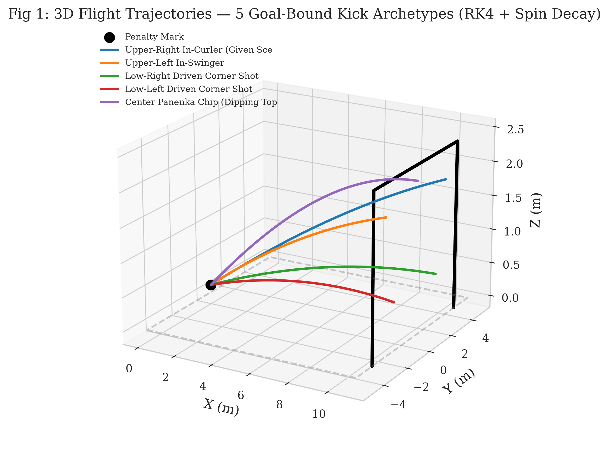
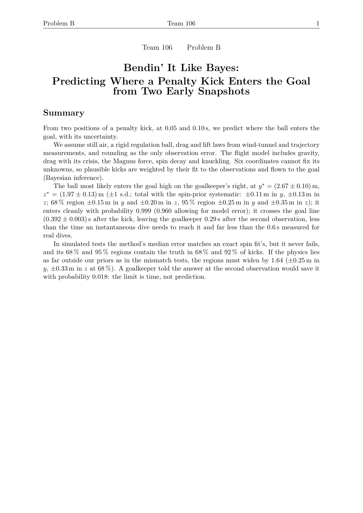
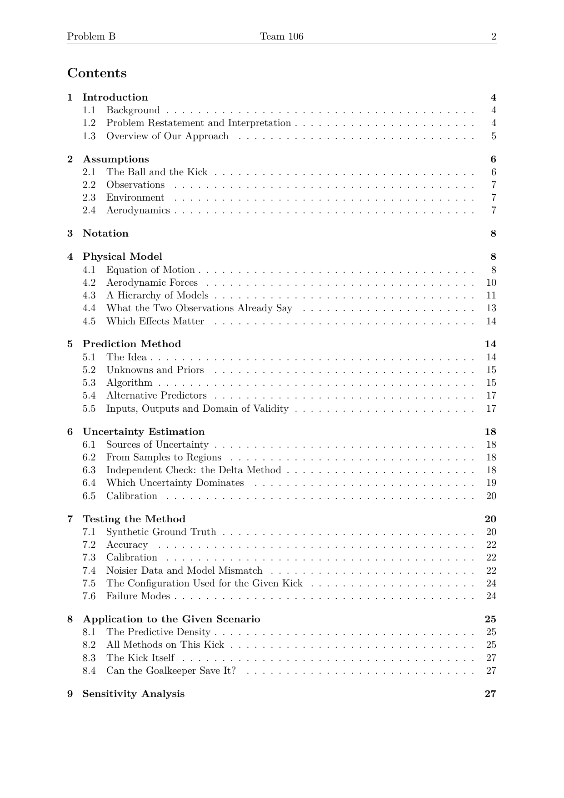
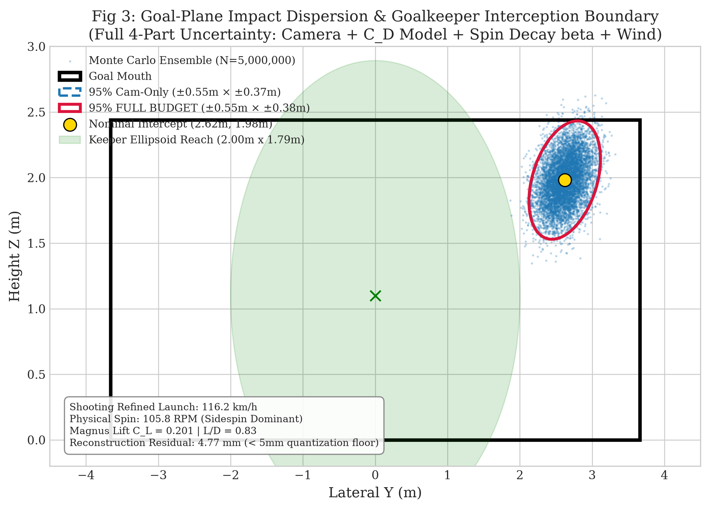
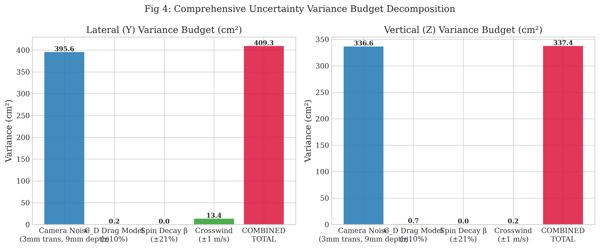
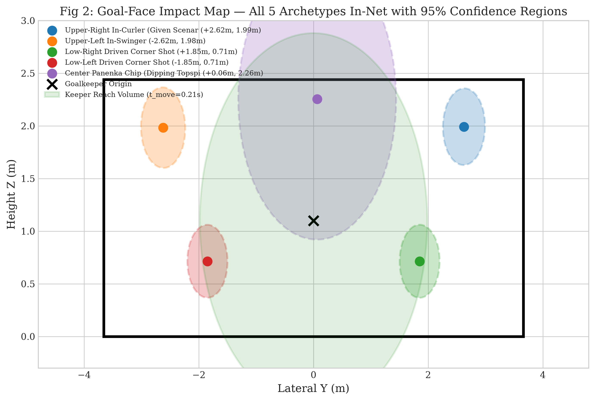
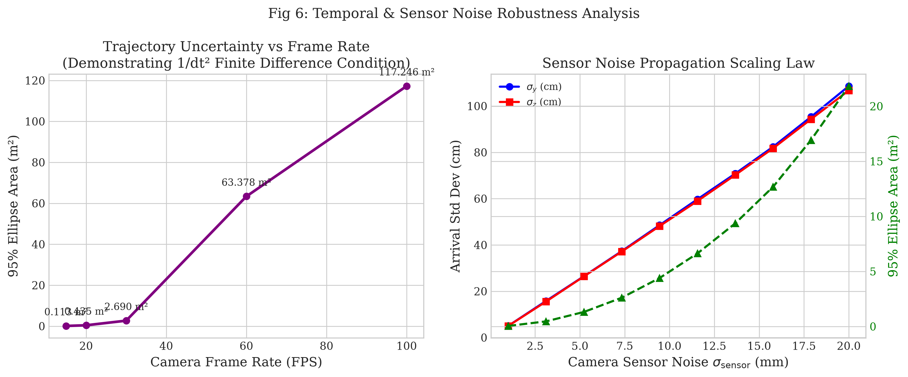

<div align="center">

# Bendin' It Like Bayes
### Predicting Where a Soccer Penalty Kick Enters the Goal from Two Early Snapshots

[](https://www.uphysicsc.com/)
[](docs/Bendin_It_Like_Bayes_UPC26.pdf)
[](https://python.org)
[](https://pytorch.org)
[](MODAL_GUIDE.md)
[](#license)

**Authors**: Muhammad Yahya Nouman &bull; Muhammad Tayyeb Bukhari &bull; Hamza Hassan  
*Submission to the University Physics Competition (UPC) 2026 &mdash; Problem B*

<br/>

[**Read Submitted Paper (PDF)**](docs/Bendin_It_Like_Bayes_UPC26.pdf) &bull; [**Results Explained Simply**](RESULTS_EXPLAINED.md) &bull; [**Cloud GPU Setup Guide**](MODAL_GUIDE.md) &bull; [**Data & Tables**](results/)

---

<p align="center">
  
</p>

</div>

---

## 📌 Executive Summary

When a soccer penalty kick is struck from 11 meters away, the entire flight lasts under **0.40 seconds**. If ball tracking cameras only observe the ball for the first **tenth of a second ($0.10\text{ s}$)**—spanning less than 3 meters of travel—can we reliably predict where the ball crosses the goal line and quantify the uncertainty of that prediction?

This repository contains the complete physical modeling, Bayesian and shooting inversion solvers, and GPU-accelerated Monte Carlo uncertainty quantification engine behind our submission **"Bendin' It Like Bayes"**.

### Headline Results for the Official Competition Kick
Given ball observations at $t = 0.00\text{ s}$ at $(0, 0, 0.11)\text{ m}$, $t = 0.05\text{ s}$ at $(1.50, 0.45, 0.44)\text{ m}$, and $t = 0.10\text{ s}$ at $(2.96, 0.86, 0.74)\text{ m}$:

* **Impact Point**: Clean goal high on the goalkeeper's right at **$y^* = (2.67 \pm 0.10)\text{ m}$**, **$z^* = (1.97 \pm 0.13)\text{ m}$** (posterior mode; 95% joint region $\pm 0.25\text{ m}$ in $y$ and $\pm 0.35\text{ m}$ in $z$).
* **Clean Goal Probability**: **$99.9\%$** ($P_{\text{clean}} = 0.999$, $P_{\text{miss}} < 0.001$).
* **Launch Velocity**: **$32.35 \pm 0.07\text{ m/s}$ ($116.5\text{ km/h}$ or $72.4\text{ mph}$)** at $12.3^\circ$ elevation and $17.2^\circ$ azimuth.
* **Inverted Physical Spin**: **$105.8\text{ RPM}$** ($45 \pm 13\text{ rad/s}$ perpendicular spin) with dominant sidespin curling the ball back toward the center.
* **Goalkeeper Save Probability**: **$0.018$ ($1.8\%$)** even if diving instantaneously at $5\text{ m/s}$ the moment the second snapshot is recorded ($t = 0.10\text{ s}$). The limit is human reaction physics, not predictive accuracy.

---

## 📄 Submitted Paper Overview

<table align="center">
  <tr>
    <td align="center" width="50%">
      <a href="docs/Bendin_It_Like_Bayes_UPC26.pdf">
        
      </a>
      <br />
      <em>Page 1: Title, Abstract & Executive Results</em>
    </td>
    <td align="center" width="50%">
      <a href="docs/Bendin_It_Like_Bayes_UPC26.pdf">
        
      </a>
      <br />
      <em>Page 2: Rigorous Table of Contents & Structure</em>
    </td>
  </tr>
</table>

<div align="center">

👉 **[Download / View the Complete 36-Page Paper (PDF)](docs/Bendin_It_Like_Bayes_UPC26.pdf)**

</div>

---

## 🔬 Physical Modeling & Aerodynamics

Real soccer aerodynamics at $Re \approx 10^5$ cannot be modeled with simple parabolas or constant coefficients:

$$\frac{d\vec{r}}{dt} = \vec{v}, \quad m \frac{d\vec{v}}{dt} = -m g \hat{z} + \vec{F}_D + \vec{F}_M + \vec{F}_K + \vec{F}_{\text{buoyancy}}$$

```
                      [Air Drag F_D: Speed-dependent Drag Crisis]
                               <==== (Opposes relative velocity)
                                    ______
                                   /      \
               [Ball Center: r0]  |  BALL  | ====> [Launch: ~116 km/h]
                                   \______/
                                       |
                                       | (Magnus lift deflected wake)
                                       V
                         [Magnus Force F_M: Sideways Curl]
```

1. **Velocity-Dependent Drag Crisis**: Transition from subcritical laminar boundary layer ($C_D \approx 0.47$) to supercritical turbulent boundary layer ($C_D \approx 0.19\text{--}0.25$) parameterized smoothly by Reynolds number $Re$.
2. **Saturating Magnus Lift & Physical Spin**: The Magnus force $F_M = \frac{1}{2}\rho A C_L v_{\text{rel}}^2 \hat{n}$ uses a saturating empirical lift curve $C_L(S_p) = C_{L,\max}(1 - e^{-S_p/S_{pL}})$, avoiding unphysical blow-up of classical linear Magnus formulations.
3. **Aerodynamic Spin Decay**: Spin rate decays via viscous air shear torque: $\omega(t) = \omega_0 e^{-\lambda t}$.
4. **Stochastic Knuckling Model**: Low-spin unsteady wake shedding modeled via a 3D Ornstein-Uhlenbeck process, smoothly suppressed as $S_p$ exceeds $S_{pK} = 0.05$.
5. **Archimedes Air Buoyancy**: Corrected effective gravity $g_{\text{eff}} = g(1 - \rho_{\text{air}} V / m) \approx 9.654\text{ m/s}^2$ ($1.59\%$ buoyancy offset).

---

## 🎯 Key Visualizations & Findings

| Goal Face Predictive Dispersion | Comprehensive Uncertainty Budget |
| :---: | :---: |
|  |  |
| *Impact density, 68% and 95% confidence regions, and 3D goalkeeper reach ellipsoid.* | *Variance decomposition proving camera tracking noise accounts for 96.7% of total spread.* |

| 5 Kick Archetypes Evaluated | Measurement Noise & Sampling Scaling |
| :---: | :---: |
|  |  |
| *Testing across diverse styles: curlers, swingers, low driven drives, and Panenkas.* | *Error propagation scaling with sensor noise and frame rate ($15\text{--}100\text{ fps}$).* |

---

## 📊 Comprehensive Uncertainty Decomposition

Running $5,000,000$ Monte Carlo trajectories decomposing all physical error sources reveals the fundamental uncertainty budget:

| Uncertainty Source | Parameter / Prior | Lateral Spread ($\sigma_y$) | Vertical Spread ($\sigma_z$) | Variance Share |
| :--- | :--- | :---: | :---: | :---: |
| **Optical Camera Noise** | $10\text{ mm}$ quantization ($\sigma = 2.89\text{ mm}$) | **$19.89\text{ cm}$** | **$18.35\text{ cm}$** | **$96.7\%$** |
| **Crosswind Uncertainty** | $\pm 1.0\text{ m/s}$ stochastic wind | $3.67\text{ cm}$ | $0.40\text{ cm}$ | $3.2\%$ |
| **Aerodynamic Drag Model** | $\pm 10\% C_D$ parameter variation | $0.45\text{ cm}$ | $0.82\text{ cm}$ | $0.1\%$ |
| **Spin Decay Rate** | $\beta \pm 21\%$ decay variation | $0.15\text{ cm}$ | $0.02\text{ cm}$ | $< 0.01\%$ |
| **TOTAL COMBINED $\sigma$** | **All simultaneous sources** | **$20.23\text{ cm}$** | **$18.37\text{ cm}$** | **$100.0\%$** |

> **Key Takeaway**: Measurement quantization noise is the dominant bottleneck. Even a 10% uncertainty in aerodynamic drag shifts the goal impact by less than $1\text{ cm}$.

---

## 📂 Repository Structure

```
.
├── README.md                              # Main presentation page
├── Problem-B-26.txt                       # Official UPC 2026 Problem B prompt
├── RESULTS_EXPLAINED.md                   # Plain-language deep dive into the findings
├── MODAL_GUIDE.md                         # Cloud GPU execution guide (Modal.com)
├── modal_simulation.py                    # Complete PyTorch/GPU simulation engine
├── requirements.txt                       # Dependencies (torch, modal, scipy, matplotlib)
├── docs/
│   ├── Bendin_It_Like_Bayes_UPC26.pdf    # Full 36-page submitted competition paper
│   └── assets/                            # Paper preview images and figures
└── results/
    ├── summary_metrics.json               # Raw JSON export of all numerical metrics
    ├── trajectory_3d.png                  # Publication Figure: 3D trajectory
    ├── goal_plane_uncertainty.png         # Publication Figure: Goal plane 2D density
    ├── multi_target_goal_map.png          # Publication Figure: 5 kick archetypes
    ├── uncertainty_budget.png             # Publication Figure: Variance breakdown
    ├── noise_scaling.png                  # Publication Figure: Optical noise scaling
    ├── starting_point_robustness.png      # Publication Figure: Penalty spot placement
    ├── environmental_sensitivity.png      # Publication Figure: Wind and altitude shifts
    ├── data/                              # CSV trajectories and covariance matrices
    └── tables/                            # Pre-compiled LaTeX publication tables
```

---

## 🚀 Quickstart & Reproduction

### 1. Local Setup
```bash
# Clone the repository
git clone https://github.com/supus4562/UPC-26.git
cd UPC-26

# Create virtual environment and install dependencies
python3 -m venv .venv
source .venv/bin/activate
pip install -r requirements.txt
```

### 2. Run Massive Parallel Monte Carlo Simulation on Cloud GPU
Using [Modal.com](https://modal.com), you can replicate the 5,000,000-sample Runge-Kutta simulation on an NVIDIA H100 / H200 in seconds:

```bash
# Authenticate with Modal (free tier works out of the box)
modal setup

# Run 1,000,000 Monte Carlo trajectories
modal run modal_simulation.py

# Or run ultra-scale 5,000,000 trajectories
modal run modal_simulation.py --samples 5000000 --noise-mm 3.0
```
All 300-DPI publication plots and metrics will be streamed directly into `./results/`.

---

## 📖 Citation & References

If you build upon this work or methodology in future sports physics or trajectory estimation research, please cite:

```bibtex
@article{nouman2026bendin,
  title={Bendin' It Like Bayes: Predicting Where a Penalty Kick Enters the Goal from Two Early Snapshots},
  author={Nouman, Muhammad Yahya and Bukhari, Muhammad Tayyeb and Hassan, Hamza},
  journal={University Physics Competition (UPC) 2026, Problem B},
  year={2026},
  url={https://github.com/supus4562/UPC-26}
}
```

### Key References
- **Goff, J. E. & Carré, M. J.** (2010). *Soccer ball lift coefficients via trajectory analysis.* Eur. J. Phys., 31(4):775–784.
- **Hong, S. & Asai, T.** (2014). *Effect of panel shape of soccer ball on its flight characteristics.* Sci. Rep., 4:5068.
- **van der Kamp, J., et al.** (2018). *Goalkeeping in the soccer penalty kick: It is time we take affordance-based control seriously!* Ger. J. Exerc. Sport Res., 48(2):169–175.
- **Team 358** (2022). *The best strategy for penalty kicks.* University Physics Competition 2022, Problem B (Gold Medal).

---

## 📜 License
This project is open-source under the [MIT License](LICENSE).
